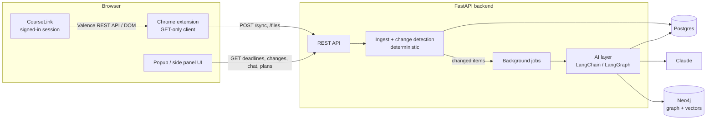

# GryphCal Agent — Project Spec

## Goal

A personal AI course agent for University of Guelph students, built from scratch as a resume
project targeting AI/SWE co-op roles (Python + TypeScript services, APIs, SQL, background jobs,
LangChain/LangGraph agents with tools, retrieval, structured outputs, memory, evals,
human-in-the-loop, messy document data).

Two goals with equal weight: **ship quickly** and **the user can explain every part.**

## Architecture

## Data collection approach

CourseLink is D2L Brightspace. Brightspace exposes the Valence REST API under `/d2l/api/...`,
and requests made from the signed-in browser context can use the existing session. Prefer the API
over DOM scraping because it returns JSON and is far less brittle. **This must be verified first
(Milestone 0)** — fall back to DOM scraping only for data the API doesn't return.

Candidate endpoints to verify (versions come from `GET /d2l/api/versions/`):

- Enrollments: `GET /d2l/api/lp/{ver}/enrollments/myenrollments/` (paged, uses bookmarks)
- Assignments: `GET /d2l/api/le/{ver}/{orgUnitId}/dropbox/folders/`
- Quizzes: `GET /d2l/api/le/{ver}/{orgUnitId}/quizzes/`
- Announcements: `GET /d2l/api/le/{ver}/{orgUnitId}/news/`
- Content tree: `GET /d2l/api/le/{ver}/{orgUnitId}/content/toc`
- Grades: `GET /d2l/api/le/{ver}/{orgUnitId}/grades/values/myGradeValues/`
- Files: content topic file download, assignment/announcement attachments

Sync triggers: a `chrome.alarms` timer, and whenever a CourseLink tab is opened.
Session expiry (401/403 or login redirect) is detected, surfaced, and reported — never silent.

## Milestones

Ownership: **CC** = Claude Code builds (BUILD mode). **ME** = I build with Claude teaching (TEACH mode).

### M0 — CourseLink API spike (CC)
- Minimal MV3 extension that, from a signed-in CourseLink tab, calls each candidate endpoint and logs results.
- Test whether requests work from the background service worker (needed for timer syncs) or only from a content script.
- Save redacted sample responses to `extension/fixtures/`.
- **Done when:** a written note in `docs/PROGRESS.md` lists which endpoints work, from which context, and what each returns.

### M1 — Extension sync + backend ingest (CC)
- GET-only CourseLink client, Zod schemas, mapping to contract types.
- FastAPI + Postgres + Alembic via Docker Compose; `POST /sync` stores snapshots.
- Deterministic change detection: new/edited announcements, new/changed files (by hash), moved due dates, new deliverables. Stored as `changes` rows.
- File upload flow (`files_needed` → `POST /files`).
- Session-expired detection end to end.
- **Done when:** opening CourseLink triggers a sync, data is in Postgres, editing a fixture produces the right change rows, and tests pass.

### M2 — Calendar UI + notifications (CC)
- Side panel / popup: calendar and list view of deadlines with status and grade, change feed, session-expired banner.
- Backend notifications table; extension polls and shows `chrome.notifications`.
- Deterministic start-by calculation (uses estimate when present, a default otherwise).
- **Done when:** I can use it daily as a deadline calendar with change alerts.

### M3 — Phase 1 AI (ME)
- Workload estimator (description + rubric + attachments → hours range, difficulty, rationale; structured output).
- Re-estimate when a change affects a deliverable.
- Announcement summarizer + "affects which deliverable?" classifier.
- Time logging endpoint (CC builds endpoint + UI) and estimator eval (MAE per prompt version) (ME).

### M4 — Phase 2: material, RAG, graph (ME, CC adds UI)
- Ingest slides, handouts, descriptions, announcements; chunk + embed; Neo4j vector index.
- LLM concept extraction → Neo4j: `(Lecture)-[:COVERS]->(Concept)`, `(Deliverable)-[:REQUIRES]->(Concept)`, `(Concept)-[:PREREQUISITE_OF]->(Concept)`.
- Lecture digest with importance flags ("Lab 4 next week uses this").
- Course Q&A with citations. CC builds the chat panel UI against the contract.
- Retrieval eval set.

### M5 — Phase 3: agents and memory (ME, CC adds UI)
- Tool-calling chat agent (deadlines, announcements, material search, graph lookup, grade calculator).
- Grade what-if: deterministic calculator exposed as a tool.
- LangGraph weekly planner with interrupt for approval; CC builds the approve/reject UI.
- Memory: conversation, preferences, episodic (actual time per assignment); personal calibration of estimates.

### M6 — Polish
- Deploy backend; README with architecture diagram, eval results, demo GIF.

### Stretch
- Exam prep path via concept graph, weakest areas first.
- Supervisor agent routing to estimator / tutor / planner.

## Success metrics
- Estimator MAE (predicted vs actual hours) per prompt version.
- Retrieval: hit rate on a small test set with known source chunks.
- Graph: spot checks for duplicate/wrong concept links.
- Freshness: a CourseLink change appears on the next sync.

## Constraints
- Read-only CourseLink access.
- Syncs only while signed in; expired session is reported.
- Plain code for deterministic logic; LLM only for unstructured text and judgment.
- Single user, local first. Personal data stays on my machine until I deploy.
